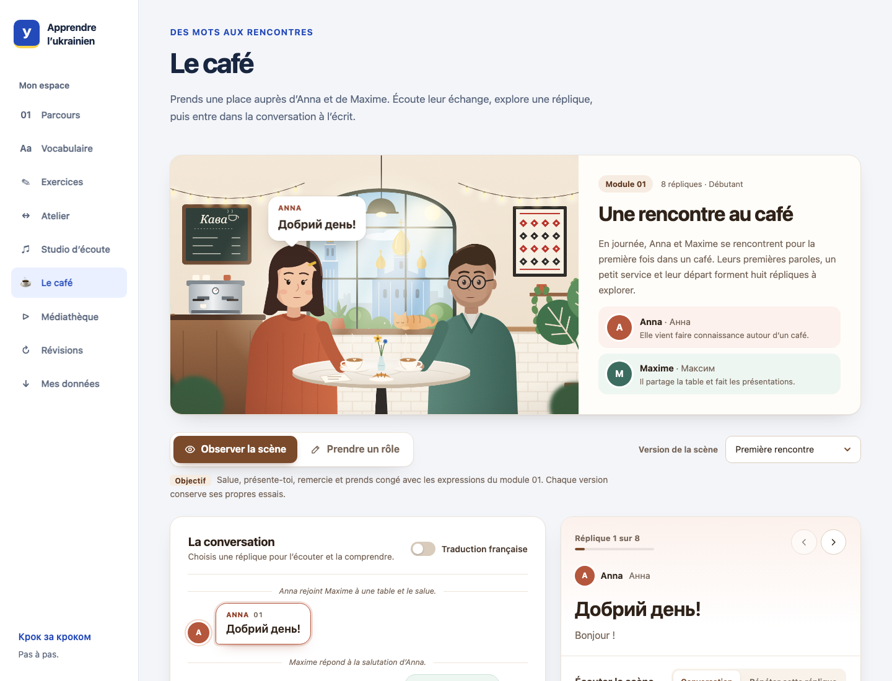

# Apprendre l’ukrainien

A web app I'm building to learn Ukrainian through French.

The idea is to keep the tools for learning in one place. Read a lesson, try its
exercises, save a word for later and come back to it in a review session. There
are also listening tools and short dialogues to practise what you've learned.

**Still in development, before V1.** The current prototype has two beginner
modules and the first versions of the learning tools. Both the course and the app
still need more work.



_The café uses prepared dialogues from the first module. You can follow each
line or write one character's replies. The interface and explanations are in French._

## What's there so far

- **Courses, vocabulary and exercises** with notes, saved answers and printable
  pages. The two modules cover reading Cyrillic, introductions and simple sentences.
- **Spaced reviews** for the letters, words and phrases you choose to practise.
  Add a module pack, reveal the answer and rate your recall. Adjust the daily
  allowance or keep practicing with adaptive repeats after scheduled reviews.
- **A language workshop** to search the course material and save useful phrases.
  Optional AI tools help translate, explain a passage or review a written answer.
- **Listening and dialogue practice** with an audio studio, the café scenes and
  links to podcasts and videos. Generated audio can be saved and replayed.
- **Personal learning spaces** with accounts, progress notes and backup/restore.
  Local development also works with a single profile and no login.

The core course, exercises, notes and reviews work without an API key. Optional
AI text and voice generation use an OpenAI key on the server. Saved audio stays
playable without it. In account mode, new AI requests are currently limited to
the owner.

## Where it stands

The course currently covers the basics. Exercise correction handles the answers
it can check; free writing and unfamiliar variants still need review. AI explanations can be wrong, and the app does not assess your
pronunciation or overall language level.

Personal work is stored on the app's server in SQLite. It has export and restore,
but no Anki sync. External listening resources stay on their original hosts.

[See how the prototype works](docs/usage.md).

## Run locally

Use **Node.js 24.21.0** and **npm 11.17.0**. The repository pins both versions;
Node 26 from 26.4.0 is also supported within that major version.

```sh
git clone https://github.com/victormonnot/apprendre-ukrainien.git
cd apprendre-ukrainien
npm ci
npm run dev
```

Open `http://127.0.0.1:3000` and choose an activity from the home page.
**Cours & fiches** contains the modules, vocabulary and exercises.
No environment file is required for the core features. Local work is saved in
`.data/`, which is excluded from Git.

See the [development guide](docs/development.md) for version setup, optional
services and testing. For a hosted instance, use the
[deployment guide](deploy/README.md).

## Development

Built with Next.js, React, TypeScript and SQLite. Course content is written in
Markdown, and spaced reviews use FSRS through `ts-fsrs`.

```sh
npm run check
npm test
npm run build
```

`check` covers formatting, lint and types. Unit tests cover storage, corrections
and review scheduling; separate browser and Docker tests cover the user flows
and hosting setup.

- [Prototype guide](docs/usage.md)
- [Development guide](docs/development.md)
- [Deployment guide](deploy/README.md)
- [My portfolio](https://victormonnot.com)
