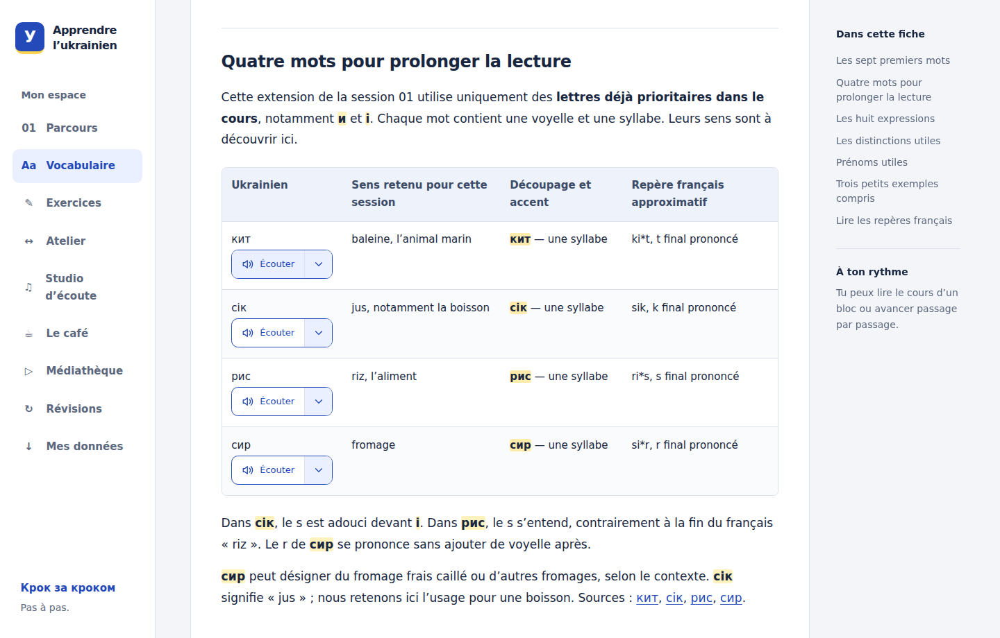

# User guide

Apprendre l’ukrainien is a pre-V1 application for learning Ukrainian through
French. The lessons and interface are in French. This guide keeps the French
button names so you can find them in the application.

The course, reference answers and café dialogues are prepared teaching content.
Optional AI assistance is labelled separately and may contain errors. Reading,
listening and self-assessment do not certify mastery. The application does not
use a microphone, record your voice or grade pronunciation.

For installation and provider settings, see the [development guide](development.md).
For hosted access, see the [deployment guide](../deploy/README.md).

## Your personal workspace

On a public installation with accounts enabled, you can browse the courses and
catalogue without signing in. Choose **Créer un compte** to register with an
identifier, a first name or nickname, and a password. Signing in gives you a
private workspace for notes, exercises, reviews, workshop entries, audio and
backups.

Keep the recovery code somewhere private: it is shown only once. **Mot de passe
oublié ?** on the sign-in page uses this code to recover the account and provides
a replacement code. Your account page also lets you change your password and
sign out.

Each account has its own learning database. Browser drafts and archived drafts
are separated by account too. The administrator explicitly creates the owner
account, which keeps the installation’s original learning database. Registration
cannot claim that account. Old browser drafts from the single-profile version
are recovered only when the owner signs in.

In this pre-V1, only the owner can request **new AI text or speech** in account
mode. Other accounts can use their own saved or imported AI results and audio.
Courses, exercises, local reference search and spaced reviews work without AI.

A default local development installation uses one profile without accounts.
The older private hosting mode also uses one profile behind HTTP authentication.
These are different from personal account mode; the deployment guide explains
the access settings.

## Read, resume and keep notes

Open **Parcours** and choose a module. Each has a course, a vocabulary sheet and
an exercise sheet, with a table of contents and an **Imprimer** button. Printed
sheets omit your personal answers and corrections.

The application’s vocabulary sheet keeps Ukrainian words and French learning
notes together.

In any sheet, open **Mon suivi et mes notes**:

- Choose a section and use **Garder ce passage** to set your return point.
- Write a note and choose **Enregistrer ma note**.
- Record your own assessment with **Enregistrer mon bilan**.

The course overview can reopen the last sheet at its saved return point. Notes
and assessments have separate save buttons. An assessment records what you say
you achieved and under what conditions; visiting a page or passing an exercise
does not fill it in automatically.

If two tabs edit the same note, the application keeps your draft and asks you
to compare it with the saved version before replacing anything. A temporary
draft may survive in the same tab, but use the save button to keep it in the
server database.

## Exercises and corrections

1. Under an exercise, open **Répondre dans l’application**, then choose
   **Commencer l’exercice**.
2. Enter your answers and state the help used for each question. You can copy
   answers from paper into these fields.
3. Use **Enregistrer le brouillon** to save incomplete work. Complete every
   answer and its help declaration before choosing **Remettre l’exercice**.
4. Read the correction after submission. Use **Réessayer l’exercice** for a new,
   empty attempt.

Exercises shared by a course and its exercise sheet use the same answers and
history. Submitted answers, declared help, reference corrections and the exercise
version remain saved for each attempt.

Automatic correction checks the written answers it can verify. It distinguishes
correct answers, answers to revisit and answers requiring review. An unknown
variant is not automatically marked wrong. Free writing, explanations and
pronunciation are not automatically assessed. A successful correction does not
establish mastery or update your personal assessment.

**Relire cette remise dans l’atelier** opens the saved submission for optional
generated written feedback. This feedback is separate from the submitted work
and its reference correction. In a conflict between tabs, the application shows
your local answers alongside the saved version so you can recover them.

## Spaced reviews

Open **Révisions** and add letters, words or expressions you have already studied.
Adding an element activates its cards: recognition for letters, comprehension
and production for words and expressions. Adding it again creates no duplicate
and does not reset its schedule. Links lead back to the relevant course passage.

The module filter helps you choose elements. The review session includes all
modules you have activated. A new course module does not activate cards or change
existing due dates by itself.

Try to answer in the field, on paper or mentally, then choose **Révéler la
réponse**. Compare your answer before selecting a rating:

| Rating        | When to choose it                                         |
| ------------- | --------------------------------------------------------- |
| **À revoir**  | You forgot, made a mistake or needed help.                |
| **Difficile** | You answered correctly without help, but with difficulty. |
| **Bien**      | You answered correctly with a normal recall effort.       |
| **Facile**    | You answered correctly immediately, without help.         |

The rating sets the next due date. Revealing an answer alone does not complete
the review. Pronunciation hints and stress marks appear on the back of the card.
Answers are self-assessed; these ratings do not grade your speaking or overall
course knowledge.

After a saved rating, the next available card opens with an empty answer. The
summary returns when nothing else is due now. If loading the next card fails,
the confirmed rating remains saved and you can retry loading. Leaving the page
stops this sequence. An active attempt can be resumed after a reload or server
restart; saved reveals and ratings are retained, and retrying the same request
does not create another review.

The current scheduling rules are:

- Started cards take priority over new cards. At most **five new cards per day**
  can be introduced, using **Europe/Paris** days, including daylight-saving
  changes. The first presentation reserves a place in that daily allowance.
- After you rate a card, other cards for the same element wait until at least
  the next day. The card you just rated can return sooner. Other due cards remain
  available when the new-card allowance is reached.
- FSRS uses a 0.9 retention target, initial steps of 1 and 10 minutes and a
  10-minute relearning step after a lapse. Later intervals are calculated by
  FSRS. The target is a scheduler setting, not a memory guarantee; parameters
  are not personally optimized in this version.

Finish an element’s active card before choosing **Mettre en pause**. Pausing
keeps its history and due dates; **Réactiver** resumes that state. The application
does not import course progress or synchronize with Anki.

## Language workshop

**Atelier** combines local French/Ukrainian reference search with optional
translation, passage explanations and written feedback. Selecting text in a
course sheet can open it in the workshop with its context and a link back.

### Search and save course references

Search for a French or Ukrainian word under **Rechercher dans mes fiches**. This
search uses course references and does not contact a provider. **Enregistrer la
référence** keeps a reference in your collection. **Ajouter aux révisions** is
a separate action that activates its existing cards without resetting them.

### Request and save generated assistance

Choose **Traduire**, **Expliquer** or **Relire un texte**, provide the text and
useful context, then send the request. Results are marked **Aide générée · à
vérifier**. They may offer alternative meanings, examples, feedback and
approximate pronunciation hints written for French speakers.

For isolated words, a proposed stressed syllable can appear in bold with its
position. Inconsistent syllable markers are omitted from new results, but that
format check does not verify the linguistic accuracy of the stress. Written
hints do not assess pronunciation. Feedback can remain uncertain when several
formulations are possible and does not score mastery.

**Enregistrer cette fiche** adds a result to your saved collection with the
request text, context, source, model and date. Equivalent saved requests in the
same context and from the same source reuse the existing entry. Whitespace and
equivalent Unicode forms are normalized; different contexts or exercise
submissions remain distinct. Saved results retain their original content and
model. Generated results do not automatically create review cards.

Only an explicit generation request sends your text, context and source
metadata to OpenAI. An exercise review sends the submitted instructions and
answers, without your personal notes or the rest of your progress. Requests use
`store: false`; the provider’s own data-retention rules still apply. Provider
calls are billed to the account associated with the server’s API key.

Successful generated responses are stored on the application server so they can
be recovered after a lost connection. Saving a sheet also adds it to the visible
collection. Retrying the same completed request does not regenerate it; failure
before local storage may require another provider call. Text generation allows
one request at a time and four starts per minute per workspace. Local tools
remain available if the provider is unavailable.

## Audio and listening studio

**Écouter** buttons appear in course and vocabulary tables, workshop entries and
revealed review answers. They read the reference Ukrainian text. Isolated
letters are not presented as sounds within words. Generated examples use the
exact text saved with their workshop result.

The button changes to **Pause** during playback. Its arrow opens speed, voice
and stop controls; Escape closes the menu. **0,75×** slows the same recording,
preserving pitch when the browser supports it. Only one shared audio player runs
at a time in a page. Switching passage or leaving the page stops playback;
hiding the tab pauses it. Opening a page never starts audio automatically.

The browser remembers your voice choice and shares it with other tabs of the
same application. Changing it stops players that follow this preference, and
you explicitly start the next listen. The café uses fixed character voices.

**Studio d’écoute** provides words and phrases from both modules, including
short introductions and sentence-building practice. Choose a passage and a mode:

| Mode              | Activity                                                                                                |
| ----------------- | ------------------------------------------------------------------------------------------------------- |
| **Écouter**       | Listen once, then replay as needed.                                                                     |
| **Répéter après** | Choose 1, 3 or 5 plays with 2, 4 or 6 seconds of silence between them. Pausing also pauses the silence. |
| **Shadowing**     | Speak along with a passage you already understand.                                                      |

You choose when to move to the next passage. The studio does not request
microphone access, record your voice, assign a grade or register a learning
result.

The available voices are **Masculine** (Cedar, the default) and **Féminine**
(Nova), both OpenAI speech synthesis. Their presence does not certify Ukrainian
pronunciation quality. The human recordings linked in the course provide
another reference. Text-generation model settings do not change the speech
model; provider configuration is described in the development guide.

Requesting an audio clip that is not already saved sends its text to OpenAI.
The resulting private WAV is stored with its text, origin, voice, model and
date. The same normalized text, voice, model and instruction version reuse that
clip; replaying it does not request another synthesis. Saved clips remain
playable when the provider is unavailable. New synthesis allows one request at
a time and twelve new clips per minute per workspace, up to 1,000 characters
and 8 MiB per file. A failure before storage can require another synthesis.

Older Marin and Lesya recordings retain their metadata and audio URLs, but these
voices are no longer offered for new listens in the interface. An old Marin
preference now selects Cedar; Lesya selects Nova, without starting playback.

## The café

**Le café** presents two prepared versions of a first meeting between Anna and
Maxime. Each contains eight lines using module 01 greetings, introductions,
thanks and farewells. A scene and transcript establish the setting; translation
and pronunciation hints are available on demand. The dialogues are authored
content, without model improvisation.

**Écouter la conversation** plays from the selected line. Anna uses Nova and
Maxime uses Cedar in both versions, including replay, repetition with silences
and model answers in role practice. The voices are synthetic and remain tied
to their characters regardless of your voice preference elsewhere.

Playback keeps the chosen speed between lines. The café player’s menu controls
speed; changing version, activity or line manually stops the sequence. Opening
the scene does not start playback. **Enregistrer l’expression** saves a line’s
reference in the workshop. **Ajouter aux révisions** separately activates its
existing cards without duplicates or schedule resets.

In **Prendre un rôle**, write Anna’s or Maxime’s four lines. Drafts are separate
for each version and character. Use **Enregistrer le brouillon** to save.
Switching character, version or back to observation first saves changes; if it
fails, the fields remain available for retry. A temporary copy in the same tab
supplements the server save. Conflicting tabs show both texts before replacement.

**Remettre mon essai** saves your exact text, declared help and scene version,
then starts an empty attempt. Model answers appear after submission or when you
explicitly ask for help; viewing one marks that attempt as assisted. Comparison
ignores case, extra whitespace and punctuation. It indicates a matching form or
a formulation to compare, without declaring an alternative wrong or grading
mastery. Past attempts stay unchanged if the scene later evolves. No microphone
is used.

## Resource library

**Médiathèque** links four Ukrainian Lessons resources about the alphabet,
greetings and introductions. Their recordings are in Ukrainian with English
explanations; the application provides French listening goals and links to
module 01. Module 02 also includes listening and reference links in its course.

Choose **Charger le lecteur** to contact the YouTube or Buzzsprout host. External
players are not loaded before this action and playback does not start
automatically. Media stays with its publisher and is not copied into the
application database or repository. The audio guide opens on its author’s site.
Use **Ouvrir la source officielle** if an embedded player is unavailable.

**Garder ce repère** saves the current playback position or a time you enter.
The next opening prepares that position and waits for you to start playback.
Displayed durations are approximate, and podcast adverts can move passages.
Closing the player or leaving the page stops playback; hiding the tab pauses it.

Use **Enregistrer mes notes** separately from the bookmark. A temporary draft
can be recovered in the same tab, and concurrent versions are shown before
replacement. Repeating a received save does not apply it twice. Opening or
listening to a resource does not record an achievement or add review cards.

## Backups and restoration

Open **Mes données**, choose **Créer une sauvegarde**, then **Télécharger**.
Keep a downloaded copy on another device or storage medium: a backup on the
same server cannot protect against losing that server. The `.sqlite3` file
contains personal data and saved audio **without encryption**.

Backups contain the learning profile, notes, assessments, saved drafts,
submissions, review history and schedules, workshop entries, café attempts,
resource notes and bookmarks, and saved audio. They exclude API keys, browser
preferences, unsaved input and external media. They also exclude account
passwords, sessions and recovery codes.

### Check a backup

Choose **Vérifier cette sauvegarde** beside a saved copy, or upload one with
**Choisir un fichier de sauvegarde**. Inspection shows a summary without
replacing current work. This pre-V1 accepts only backups whose **schema and
migration history exactly match the installed version**. It checks SQLite
integrity, constraints and table relationships. Editing a database by hand is
not a supported content import method.

| Workspace                     | Maximum file to inspect or import | Retention on the server                             |
| ----------------------------- | --------------------------------- | --------------------------------------------------- |
| Owner or local single profile | 256 MiB                           | Manual and safety backups are retained.             |
| Member account                | 8 MiB                             | Latest three manual backups and two safety backups. |

An inspection expires after one hour. Up to five files can await restoration.
Download member backups you want to keep beyond the retention limit.

### Replace current work

Restoration **replaces the current learning data; it does not merge histories**.
In account mode, it affects only the signed-in account’s learning database.
Account identities, passwords and sessions remain separate and unchanged.

1. Inspect the file and review its summary.
2. Tick **Je veux remplacer le travail actuel par cette sauvegarde.**
3. Choose **Restaurer cette sauvegarde**.
4. After completion, choose **Ouvrir le travail restauré** and reload other tabs.

A safety backup of the previous state is created before replacement and can
be downloaded or restored. Replacement is transactional: failure before commit
leaves the previous data intact. If the network response is lost, retrying the
same operation retrieves its result without restoring twice.

Requests from the old state cannot change restored data, including text or audio
generation still in progress. When other tabs reopen, their old drafts are set
aside in that tab. Use **Télécharger les anciens brouillons** in **Mes données**
to retrieve them. They are not inserted into restored work automatically. This
JSON export helps recover text; it is separate from a complete backup.

Backup files stay in the account’s private server directory. Restoration is
designed for one application server. It does not synchronize separate
installations or publish their data.
